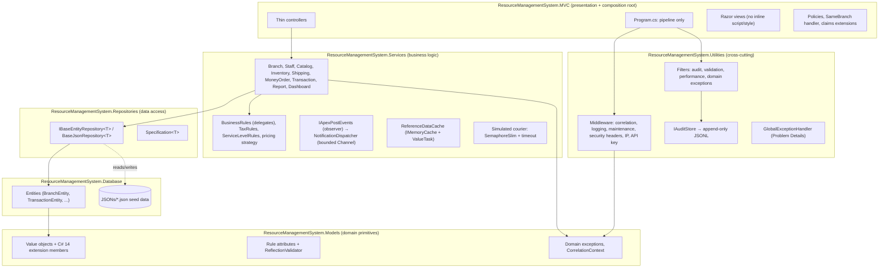
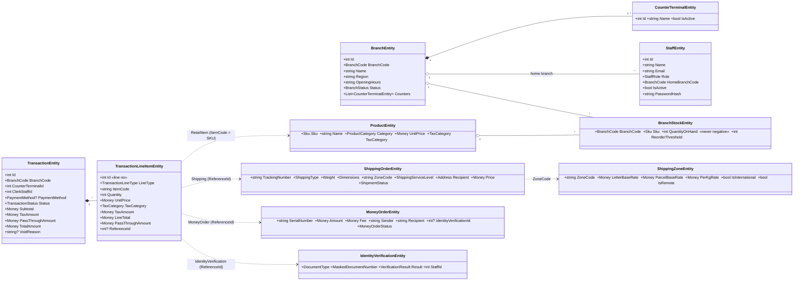
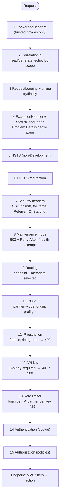

# ApexPost Counter Platform: Design (Week 2)

This document explains how the Week 1 TechNova Resource Management System became the ApexPost
Counter Platform, and why each decision was made. It covers the architecture, the domain model,
the middleware pipeline, filters, concurrency, security and auditing, and the Architecture
Decision Records (ADRs) for Week 2.

Contents

1. [Did the Week 1 architecture survive?](#1-did-the-week-1-architecture-survive)
2. [Architecture](#2-architecture)
3. [Domain model](#3-domain-model)
4. [Business rules: where each is enforced](#4-business-rules-where-each-is-enforced)
5. [Pricing and tax](#5-pricing-and-tax)
6. [Middleware pipeline](#6-middleware-pipeline)
7. [Filters versus middleware](#7-filters-versus-middleware)
8. [Async, Task.WhenAll, SemaphoreSlim, ValueTask and what was measured](#8-async-taskwhenall-semaphoreslim-valuetask-and-what-was-measured)
9. [DI lifetimes](#9-di-lifetimes)
10. [Advanced C# 14 usage](#10-advanced-c-14-usage)
11. [Security and audit](#11-security-and-audit)
12. [Architecture Decision Records](#12-architecture-decision-records)
13. [SOLID mapping](#13-solid-mapping)
14. [Testing strategy](#14-testing-strategy)
15. [Known limitations and next week](#15-known-limitations-and-next-week)

---

## 1. Did the Week 1 architecture survive?

**Yes: the layered Controller → Service → Repository architecture survived, but its internals were redesigned.**
The layering was the part of Week 1 that worked. Business rules lived in services, controllers stayed
thin, and persistence sat behind `IBaseEntityRepository<T>`. The ApexPost domain is larger, but it
does not need a different shape. What did not survive was the *implementation* inside the layers:

| Week 1 | Problem for ApexPost | Week 2 |
| --- | --- | --- |
| Synchronous repository (`GetAll()`, `File.ReadAllText`) | The brief requires async I/O end to end and bounded concurrency | `IBaseEntityRepository<T>` is fully async with `CancellationToken`; reads return `ValueTask` from an in-memory snapshot |
| `lock` around file access in a *scoped* repository/audit store | A new lock per request, so nothing was actually serialised; `lock` cannot span `await` | Singleton repositories, one `SemaphoreSlim` per file, copy-on-write snapshots, atomic temp-file + `File.Move` writes |
| EF Core package and `ApplicationDbContext` left in Database/Repositories | The brief says no ORM this week | Removed; Database holds plain entities and seed JSON only |
| Services referenced Utilities (web middleware) | The business layer depended on ASP.NET Core plumbing | Services reference only Models and Repositories (plus Microsoft.Extensions.*). Utilities references only Models |
| Runtime writes went into the committed seed files | Every demo dirtied git; tests shared state | Seed files are copied to a configurable data directory (`App_Data`) on first run; tests use a temp folder each |
| Primitive strings/decimals everywhere | Easy to pass a SKU as a branch code; rounding scattered | Value objects `Money`, `Weight`, `Dimensions`, `Address`, `BranchCode`, `Sku`, `MaskedDocumentNumber` |
| Legacy console project in the solution | Not part of the product | Removed from the solution (cleanup script deletes the folder) |

ADR-W2-01 records this decision.

## 2. Architecture

**Dependency rule:** arrows point inward. Controllers call services and never repositories. Services
never reference the web layer. The Models project depends on nothing. Next week's database
replaces `BaseJsonRepository<T>` only.

| Project | Responsibility | References |
| --- | --- | --- |
| Models | Value objects, validation attributes + cached reflection validator, domain exceptions, `CorrelationContext` | none |
| Database | Persistence entities, enums, seed JSON (copied to output as `SeedData/`) | Models |
| Repositories | `IBaseEntityRepository<T>`, `BaseJsonRepository<T>`, specifications, JSON converters, seeder | Database |
| Services | All business rules and workflows, events, notifications, cache, courier simulation | Models, Repositories, Microsoft.Extensions.* |
| Utilities | Middleware, filters, audit store, exception handler, options | Models, ASP.NET Core |
| MVC | Composition root, pipeline, auth policies, thin controllers, views | Services, Utilities |
| Tests | xUnit unit tests + WebApplicationFactory integration tests | MVC |

## 3. Domain model

### Entities versus value objects

| Kind | Types | Why |
| --- | --- | --- |
| **Entities** (identity, lifecycle) | Branch, Staff, Product, BranchStock, ShippingZone, Transaction (+ lines as owned children), ShippingOrder, MoneyOrder, IdentityVerification, Notification | They change over time and are referred to by id (a transaction goes Open → Paid → Refunded but stays transaction 42) |
| **Value objects** (`record struct` / `record`, equality by value, immutable) | `Money`, `Weight`, `Dimensions`, `Address`, `BranchCode`, `Sku`, `MaskedDocumentNumber` | No identity; two `$4.95` are the same. They validate once at construction (`new BranchCode("br-1")` throws), so invalid values cannot travel through the system |

`MaskedDocumentNumber` deserves a note. It has no public constructor. You can build it from a raw
number (`FromRaw` keeps the last four characters) or rehydrate an already-masked value
(`FromMasked` rejects anything unmasked). The type therefore makes it impossible to store a
full document number.

### How a mixed basket is modelled

**Composition with a discriminator, not an inheritance hierarchy.** A `TransactionEntity` owns a list
of `TransactionLineItemEntity`. Every line has the same shape: code, quantity, unit price, tax
category, tax, net, pass-through. `LineType` (RetailItem, Shipping, MoneyOrder, IdentityVerification)
says what the line is, and `ReferenceId` points to the record behind a service line.

Alternatives considered (ADR-W2-02):

* *Inheritance* (`RetailLine : Line`, `ShippingLine : Line`...). This reads naturally in C#, but it
  needs polymorphic JSON now and table-per-hierarchy mapping next week. Most of the behaviour is
  common anyway (totals, tax, removal).
* *Interfaces* (`IBasketItem`). These have the same serialisation problem, and the services would
  still need to switch on the concrete type.

Line-specific behaviour is expressed with **pattern matching on `LineType`**, which the compiler
checks
for exhaustiveness: tax category (`TaxRules.CategoryFor`), line removal (`RemoveLineAsync` cancels
the shipment or money order behind the line), and revenue split (`RetailNet` and `ServicesNet`
extension properties). Money order face value is kept in `PassThroughAmount`. It is money collected
for a recipient, not ApexPost revenue, so the reports keep it out of sales.

## 4. Business rules: where each is enforced

| Rule (from the brief) | Enforced in | Proved by |
| --- | --- | --- |
| Branch stock can never go negative; a sale fails if stock is insufficient | `InventoryService.DeductAsync` (all-or-nothing, under a per-branch `SemaphoreSlim`); `BranchStockEntity.QuantityOnHand` setter refuses negatives as a last line of defence | `StockRuleTests` (incl. 2× oversubscribed concurrent sales never oversell) |
| Inactive staff cannot open/process transactions | `StaffService.EnsureCanTransactAsync` re-loads the staff record on **every** mutating call (a cookie can outlive a deactivation); inactive staff also cannot sign in | `TransactionRuleTests.InactiveStaff...`, `DeactivatedClerk_WithAStillValidCookie...`, `InvalidCredentials_ShowGenericError` |
| A clerk can only transact at their assigned branch | Same method compares the *stored* home branch, not the claim; the `SameBranchOnly` policy blocks other-branch pages earlier | `Clerk_CanOnlyTransactAtTheirAssignedBranch`, `ForgedBranchClaim_IsRejected`, `Clerk_CannotOpenAnotherBranchDashboard` |
| Money order above a configurable threshold needs a successful identity verification **in the same transaction** | `TransactionService.PayAsync`: rule delegate `RequiresIdentityVerification` (threshold from `BusinessRules:MoneyOrderIdentityThreshold`); only a *Passed* verification that is still a line on *this* basket counts | `MoneyOrderIdentityRuleTests` (failed check, other transaction's check, boundary values, config) |
| Parcels over the service-level maximum are rejected | `ServiceLevelRules.EnsureAcceptable` (tuple pattern match), called by `ShippingService.QuoteAsync` before pricing | `ParcelWeightLimitTests` |
| Voids and refunds require the Branch Manager role and a reason | `BranchManagerOnly` policy on the actions **and** `TransactionService.ReverseAsync` (role, same branch, active, `[NotBlank, Matches(.{5,})]` reason) | `Clerk_Gets403_OnVoid`, `Void_RequiresAReason`, `ManagerFromAnotherBranch_CannotVoid`, `Manager_CanVoid_WithAReason_AndItIsAudited` |
| A closed branch cannot accept transactions | `BranchService.EnsureOpenForTradingAsync` on open **and** on every basket change (closing mid-shift freezes open baskets) | `ClosedBranch_CannotAcceptTransactions`, `ClosingABranch_StopsOpenBasketsBeingChanged`, `ClosedBranchClerk_CannotOpenABasket` |

Rules are checked in the service layer, and defence in depth repeats them at the edge (policies) and
in the data (entity setters). The web layer never decides a business rule on its own.

## 5. Pricing and tax

**Strategy + delegates + pattern matching** (ADR-W2-03).

* `IShippingPricingStrategy` (Strategy pattern). `ShippingService` owns the workflow: validate the
  command, look up the zone from the cache, apply the service-level limits, and ask the courier for
  the live fuel rate. The strategy owns the arithmetic. A partner or promotional strategy can be
  registered in DI without touching the service.
* `DefaultShippingPricingStrategy`:
  1. Chargeable weight is the actual weight, or for parcels `max(actual, volumetric)` with volumetric = L×W×H / 5000.
  2. Base postage is a tuple pattern match on `(ShippingType, kg)`: letter ≤ 250 g, large letter,
     satchel ≤ 500 g, then base + per-kg × ⌈kg − 0.5⌉.
  3. Service loading is a pattern match: Standard 0, Express +60 % of base, Registered +$4.50
     (signature on delivery).
  4. Surcharges are a list of `ShippingSurchargeRule` **delegates** (fuel, remote area, oversize > 100 cm).
     Adding a peak-season surcharge is one lambda, and `Surcharges_ArePluggableDelegates` proves it.
  5. Tax: `TaxRules.CategoryFor(Shipping, international)`. Domestic is Standard (10 %) and
     international is Exempt (an exported service).
* `TaxRules` is one pattern-matched table for every line type. Retail uses the product's category
  (Standard 10 %, Reduced 5 %, Exempt 0 %). Money order fees are Exempt (financial supply).
  Identity checks are Standard. Prices are tax-exclusive; tax is calculated per line and rounded
  half away from zero to cents (`Money.ApplyRate` → `RoundedToCents`).
* Money order fee is the `BusinessRules.MoneyOrderFee` delegate: `max($5.00, 1.5 %)`, configurable.

Worked example (unit-tested in `PricingTests`): a 2 kg Standard parcel to Z01 is base $8.95 +
$1.10 × 2 = $11.15, plus 8 % fuel $0.89, giving net $12.04. Adding GST of $1.20 gives a total of **$13.24**.

## 6. Middleware pipeline

| # | Middleware | Why it sits here |
| --- | --- | --- |
| 1 | `UseForwardedHeaders` | Must run before anything reads the client IP or scheme. It only trusts loopback plus configured `KnownProxies` (see 11.3). |
| 2 | `CorrelationIdMiddleware` | Everything after it, including exception and rate-limit responses, gets the ID in logs and in the `X-Correlation-Id` header. It sets `CorrelationContext` (AsyncLocal) so services can stamp notifications without depending on ASP.NET Core. |
| 3 | `RequestLoggingMiddleware` | Outside the exception handler, so it logs the **final** status (500 written by the handler), not the 200 the response had when the exception happened. `try/finally` means failed requests are timed too. Inside correlation, so the log entry carries the ID. |
| 4 | `UseExceptionHandler` + `GlobalExceptionHandler`, `UseStatusCodePagesWithReExecute` | Wraps everything that can throw. It returns Problem Details (traceId + correlationId, safe message) to API/JSON callers and a friendly page to browsers. Never a stack trace. |
| 5–6 | HSTS (non-Development), HTTPS redirection | Transport security before any content is produced. HSTS is not used in Development, so a developer's localhost is not pinned to HTTPS for a year. |
| 7 | `SecurityHeadersMiddleware` | Registers headers with `OnStarting`, so they are applied to *every* response produced later, including 401/403/429/503 short-circuits and error pages. |
| 8 | `MaintenanceModeMiddleware` | Before routing and auth, so a paused system does no real work. `/health` stays up so the load balancer can tell "paused" from "down". It reads `IOptionsMonitor`, so it can be toggled without a restart. |
| 9 | `UseRouting` | After this point the selected endpoint and its metadata (`[ApiKeyRequired]`, `[IpRestricted]`, CORS and rate-limit policies) are visible. |
| 10 | `UseCors` | Must run after routing (endpoint policy) and before anything that would reject a browser preflight `OPTIONS` (the API key middleware would answer 401). |
| 11 | `IpRestrictionMiddleware` | The cheapest rejection for sensitive endpoints. It runs before key validation, so outsiders cannot probe keys at all. |
| 12 | `ApiKeyValidationMiddleware` | Authenticates the partner and stores the partner id, which the rate limiter needs as its partition key, so it must run before step 13. |
| 13 | `UseRateLimiter` | Per-partner budgets need the validated partner id from step 12. The login limit is per client IP. It runs before authentication so brute-force attempts cost almost nothing. |
| 14–15 | Authentication, Authorization | The standard order; authorization needs the principal. The fallback policy requires an authenticated user everywhere unless the endpoint opts out. |

## 7. Filters versus middleware

The rule of thumb: **middleware for concerns about the HTTP request as a whole** (they apply to static
files, health checks and the integration API alike, and need no knowledge of MVC). **Filters for
concerns that need MVC context**: the selected action and its attributes, bound arguments,
`ModelState`, `TempData` or the `IActionResult`.

| Concern | Implemented as | Why |
| --- | --- | --- |
| Correlation ID | Middleware | Must cover every request and every log line, including non-MVC endpoints and failures before MVC runs |
| Request logging and timing | Middleware | Whole-request view (static files, auth, rate limits); needs the final status code |
| Exception → Problem Details | Middleware (`IExceptionHandler`) | Last resort for anything, including failures outside MVC |
| Security headers, HSTS, HTTPS | Middleware | Transport and browser policy for every response |
| Maintenance mode | Middleware | Must stop work before routing, auth or MVC |
| IP restriction, API key, CORS, rate limiting | Middleware | Reject early and cheaply before MVC allocates anything; uses only endpoint metadata |
| Authentication / authorization policies | Middleware (+ `[Authorize]` metadata) | Framework-standard; policies are declared per action as metadata |
| **Audit** (`AuditActionFilter`) | **Action filter**, global via `AddService` | Needs the action's `[Audited("Transaction.Void", "Reason")]` attribute, the **bound arguments** (reads `Reason` without re-reading the body) and the **result or exception** to record the outcome; middleware only sees bytes and a status code |
| **Validation** (`ValidationFilter`) | **Action filter** | `ModelState` exists only after MVC model binding; it chooses between redisplaying a view, a PRG redirect or a 400 Problem Details response |
| **Performance** (`PerformanceFilter`) | **Action filter** | Measures the action alone (excluding auth, static files and pipeline work) and names it `Controller.Action`; together with request timing it shows whether slowness is in our code or around it |
| **Domain exceptions** (`DomainExceptionFilter`) | **Exception filter** | Turns `BusinessRuleViolationException` into a TempData message + redirect (PRG), `EntityNotFound` into 404 and `Forbidden` into 403; needs controller, TempData and IActionResult types |
| Branch access | Authorization policy `SameBranchOnly` (+ service checks) | Resource-based check on the `branchCode` route value; the service re-checks against the data |

## 8. Async, Task.WhenAll, SemaphoreSlim, ValueTask and what was measured

**async/await with CancellationToken end to end.** Every controller action takes a
`CancellationToken`, bound by MVC from `HttpContext.RequestAborted`. It is passed through the
services into `BaseJsonRepository`, which uses `FileStream(useAsync: true)`, `JsonSerializer.SerializeAsync`
and `SemaphoreSlim.WaitAsync(ct)`. A browser that disconnects stops the work. There are no
`.Result`, `.Wait()` or `Thread.Sleep` calls anywhere; the only delays are `await Task.Delay(…, ct)`
in the simulated courier.

| Technique | Where | Why |
| --- | --- | --- |
| `Task.WhenAll` | `DashboardService.BuildAsync` (sales, low stock, alerts, recent transactions, branch); also `GetDetailsAsync`, report services, catalogue + stock, `BranchController.Dashboard` | Independent I/O-bound reads overlap, so the page costs roughly the slowest read instead of the sum. No extra threads: it only overlaps the waiting. With a database next week each read is a network round trip, which is where this pays off. The dashboard shows "built in N ms" |
| `SemaphoreSlim` (throttle) | `SimulatedCourierRateService` (max 4 concurrent calls, configurable) | The partner API throttles clients. Excess callers wait asynchronously instead of being rejected or blocking threads. Test: 20 parallel quotes, **peak concurrency observed = 3 with limit 3** |
| `SemaphoreSlim` (mutual exclusion) | One per JSON file in `BaseJsonRepository`; one per branch in `BranchLockProvider`; one in `JsonAuditStore` | `lock` cannot be held across `await`. The per-branch lock makes "check stock, then deduct" atomic. Test: **2N concurrent single-unit sales of N items → exactly N succeed, stock ends at 0** |
| `ValueTask` + `IMemoryCache` | `ReferenceDataCache` (product catalogue indexed by SKU, zones by code); repository reads | The hit path completes synchronously, and `ValueTask` avoids allocating a `Task` on every basket line and every quote |
| Cancellation vs failure + timeout | `SimulatedCourierTrackingService` | A linked CTS with `CancelAfter(TrackingTimeoutMs)`. If *our* timeout fires, the caller is still waiting, so we return `Unavailable` → **503**. If the *caller* cancels, we rethrow `OperationCanceledException`, nobody is told and nothing is logged as an error. The distinction is `catch (OperationCanceledException) when (!callerToken.IsCancellationRequested)` |
| Bounded `Channel<T>` | `NotificationDispatcher` | Event handlers run on the request thread and must not await I/O. They enqueue, and a background service persists. With a bounded capacity (DropOldest) a burst of events cannot exhaust memory |

**Measured** (`ConcurrencyAndCachingTests.ReferenceDataCache_HitsCompleteSynchronously_AndAreFaster`,
three runs on the build machine). 2,000 product lookups took:

| Path | Time | Notes |
| --- | --- | --- |
| Repository `GetAllAsync()` + linear scan | 452–578 ms | Each call deep-copies 32 products (by design, so callers cannot corrupt the cache) |
| `ReferenceDataCache` (`ValueTask`, dictionary) | 2.6–4.2 ms | ~130–200× faster; `IsCompletedSuccessfully == true` on a hit, so no Task is allocated and no await is needed |

The repository's copy-on-read is the right default for mutable data (stock, transactions). The
cache is the right tool for read-mostly reference data. The cache is invalidated when products
change and expires after 10 minutes.

## 9. DI lifetimes

| Lifetime | Services | Reasoning |
| --- | --- | --- |
| Singleton | `BaseJsonRepository<T>` (open generic), `JsonStorageSettings`, `IAuditStore`, `IApexPostEvents`, `BranchLockProvider`, `IReferenceDataCache`, courier services, pricing strategy, `BusinessRules`, `IPasswordHasher`, all filters, `SameBranchHandler`, hosted services | They own shared state that **must** be shared: one semaphore per file, one throttle for the partner, one event hub that subscribers attach to at startup. They depend only on other singletons |
| Scoped | Business services (`TransactionService`, `ReportService`...) | Stateless today. Scoped keeps them safe to hold per-request state next week (a DbContext / unit of work) without a lifetime audit |
| Per-app (constructed once) | Middleware | Convention-based middleware is created **once**. Only singletons go in middleware constructors (`IOptionsMonitor`, `ILogger`). A scoped service captured there would leak one request's data into every later request. Per-request needs come in through `InvokeAsync(HttpContext)` or `context.RequestServices` |

Guard rails: `ValidateScopes = true` and `ValidateOnBuild = true` in `Program.cs`, so a singleton that
captures a scoped service fails at startup, not in production. Filters are added with
`Filters.AddService<T>()`, so they are resolved from DI with these same rules. Middleware reads
reloadable settings through `IOptionsMonitor<T>.CurrentValue` (maintenance mode, API keys,
performance threshold) rather than capturing a stale snapshot.

## 10. Advanced C# 14 usage

Twelve features are used, each where it solves a real problem (the brief asks for at least eight):

| # | Feature | Where | Problem it solves |
| --- | --- | --- | --- |
| 1 | Records / value objects | `Money`, `Weight`, `Dimensions`, `Address`, `BranchCode`, `Sku`, `MaskedDocumentNumber`; event args; command/report DTOs (`record`) | Value equality and immutability; validation at construction; no primitive obsession |
| 2 | Pattern matching | `TaxRules` (tuple patterns), `ServiceLevelRules` (tuple + property patterns), `DefaultShippingPricingStrategy` (relational patterns on weight bands), `StaffService.EnsureCanTransactAsync` (property patterns), `IntegrationController` (type patterns on `TrackingResult`), `RemoveLineAsync` (property patterns), `DomainExceptionMapper` | Readable rule tables; the compiler flags unhandled enum values |
| 3 | **C# 14 extension members** | `MoneyExtensions` (`money.RoundedToCents`, `ApplyRate`, `IEnumerable<Money>.Total()`, `12.5m.AsMoney`), `TransactionExtensions` (`tx.RetailNet`, `ServicesNet`, `ItemCount`, `NextLineNumber`, `RecalculateTotals()`), `ClaimsPrincipalExtensions` (`User.BranchCode`, `User.StaffId`, `User.ToStaffContext()`) | Summary *properties* on types we do not want to bloat (entities stay persistence models); controllers stop repeating `FindFirst` + parse |
| 4 | **`field` keyword** | `BranchEntity.Name/Region/OpeningHours`, `StaffEntity.Email/Name`, `ProductEntity.Name`, `BranchStockEntity.QuantityOnHand` | Trimming, normalising and guarding setters without declaring backing fields. `QuantityOnHand`'s setter enforces "never negative" |
| 5 | Generics with meaningful constraints | `IBaseEntityRepository<TEntity> where TEntity : class, IEntity`; `Specification<T> where T : class`; `StringValueConverter<T> where T : struct` | One repository implementation for every entity, because the constraint guarantees an integer key the store can assign |
| 6 | Specification pattern | `Specification<T>` with `&`, `|`, `!` operators; `TransactionSpecifications`; used by every report | Report criteria composed from named pieces; translatable to SQL next week |
| 7 | Delegates and `Func`/`Predicate` | `BusinessRules` (`Predicate<Money> RequiresIdentityVerification`, `Func<Money,Money> MoneyOrderFee`, `Func<BranchStockEntity,int,bool> IsLowStock`); `ShippingSurchargeRule` delegate list | Configurable rules (threshold from config) and pluggable surcharges without subclassing |
| 8 | Events (observer) | `IApexPostEvents`: `TransactionCompleted`, `StockLow`, `MoneyOrderIssued`, `TransactionVoided` (void + refund) → `NotificationDispatcher` | Notifications decoupled from business services |
| 9 | Custom attributes + cached reflection validator | `NotBlank`, `MaxLengthRule`, `InRange`, `Matches`, `DefinedEnum` + `ReflectionValidator` (metadata in `ConcurrentDictionary`, getters compiled with expression trees); `[Audited]`, `[ApiKeyRequired]`, `[IpRestricted]`, `[RedirectOnInvalidModel]`, `[JsonApi]` | Domain-level validation for every caller (forms, API, tests). The reflection cost is paid once per type. Attributes carry metadata to middleware and filters |
| 10 | async/await + CancellationToken end to end | Controller → service → repository → `FileStream` | Responsive under load; cancelled requests stop I/O |
| 11 | `Task.WhenAll`, `SemaphoreSlim`, `ValueTask` + cache | See section 8 | Parallel independent work, bounded concurrency, allocation-free hot paths |
| 12 | Cancellation vs failure, timeouts | `SimulatedCourierTrackingService`; `GlobalExceptionHandler` treats client aborts as non-errors; audit writes use `CancellationToken.None` on purpose | A timeout is a dependency failure (503); a client abort is not an error |

Also used: primary constructors on services and middleware, collection expressions (`[]`),
`[GeneratedRegex]`, `[LoggerMessage]` source-generated structured logging, and `required`/`init`.

## 11. Security and audit

### 11.1 Threats and mitigations

| Threat | Mitigation |
| --- | --- |
| Credential stuffing / brute force on login | Fixed-window rate limit (5/min per IP, configurable) on `POST /Account/Login` → 429 + Retry-After; PBKDF2-SHA256 100k iterations; same error message and same hashing cost for unknown email, wrong password and inactive account (no user enumeration) |
| Session theft | Cookie `__Host-ApexPost.Auth`: HttpOnly, Secure, SameSite=Strict, `__Host-` prefix (no Domain, Path=/), 8 h sliding (one shift); TempData and antiforgery cookies hardened the same way |
| CSRF | Global `AutoValidateAntiforgeryToken` on every unsafe-method form post; SameSite=Strict. Test: POST without a token → 400 |
| Privilege escalation (clerk voids, other branch) | Policies `BranchManagerOnly`, `SameBranchOnly`, `CanTransact`, `StaffManagers`, `AuditViewers`; fallback policy = authenticated; **services re-check against stored data** (forged or stale claims fail) |
| XSS / clickjacking / MIME sniffing | CSP `default-src 'self'` with no inline script or style anywhere (CSS/JS are same-origin files); Razor encodes output; `X-Frame-Options: DENY` + `frame-ancestors 'none'`; `nosniff`; `Referrer-Policy`; `Permissions-Policy`; Server header removed |
| Information leakage in errors | Problem Details with a safe message + traceId + correlationId; no stack traces or exception messages (type name only in Development); full exception goes to the log only |
| Partner API abuse | Endpoint metadata `[ApiKeyRequired]`; keys from user-secrets/env per partner; SHA-256 + `FixedTimeEquals` constant-time comparison with no early exit; 401 missing/invalid, **500 if not configured** (never fails open); IP allowlist (CIDR) → 403; token-bucket rate limit **per partner** → 429 |
| Spoofed client IP | IP checks read `RemoteIpAddress` only; ForwardedHeaders trusts loopback + configured proxies only. Test: forged `X-Forwarded-For: 127.0.0.1` from a blocked IP still gets 403 |
| Open redirect after login | `Url.IsLocalUrl` + `LocalRedirect`; the domain-exception redirect only follows a same-host Referer |
| Log injection / header splitting via correlation ID | Incoming ID accepted only if ≤ 64 chars of `[A-Za-z0-9-_.]`, otherwise replaced |
| Personal data exposure | Document numbers masked at input (`****1234`), never stored, logged or audited; query strings not logged; audit fields whitelisted + redacted |
| Secrets in source control | No API key in `appsettings*.json` (empty `Integration:Partners`); `UserSecretsId` in the MVC project; demo password exists only as PBKDF2 hashes in seed data |
| Overselling under concurrency / corrupt files | Per-branch async lock; atomic temp-file writes; append-only audit |
| Denial of service by event bursts | Bounded notification channel; global request limits per partner and login |

### 11.2 CORS is not a security boundary

CORS only tells a *browser* whether JavaScript from `https://track.swiftcourier.example` may *read* a
response. It does not stop the request being sent, and it does nothing against curl, Postman or a
server-side script, which ignore CORS entirely. So the parcel-status endpoint is protected by the API
key, IP allowlist and rate limit; CORS only narrows which web origin's scripts can use it from a
browser. The policy is minimal: one origin, GET only, the `X-Api-Key`/`X-Correlation-Id` request
headers, and `X-Correlation-Id` exposed. In production a browser widget should not hold a secret
key at all. It would call the partner's own backend, which calls us with the key from an
allowlisted IP.

### 11.3 Forwarded headers and proxy risk

Behind a reverse proxy or load balancer, `RemoteIpAddress` is the proxy's address. The tempting fix,
reading `X-Forwarded-For`, is a vulnerability, because any client can send that header (the Week 1
middleware fell back to it). Here `UseForwardedHeaders` rewrites `RemoteIpAddress` **only when the
immediate peer is a trusted proxy**: loopback by default, plus `ForwardedHeaders:KnownProxies` from
configuration, with `ForwardLimit = 1`.

Warning: clearing both `KnownProxies` and `KnownIPNetworks` makes ASP.NET Core trust *every* peer.
That bug was caught by the `SpoofedForwardedForHeader_DoesNotBypassIpRestriction` test during
development.

### 11.4 What is audited, where, and how personal data is protected

* **What:** every action marked `[Audited]`. That covers login, opening a basket, adding items,
  shipments and money orders, identity verification, payment, void, refund, stock adjustment, and
  staff and branch changes. Each entry records the action name, StaffId, Role, BranchCode,
  controller/action, HTTP method and path, route values, **whitelisted** fields, status code, outcome
  (Succeeded / Rejected / Failed), business rule code on rejection, duration and correlation ID.
  Rejected attempts are audited too (e.g. `Transaction.Pay` rejected with
  `MONEY_ORDER_ID_REQUIRED`). See [AUDIT-SAMPLE.json](AUDIT-SAMPLE.json).
* **Where:** `App_Data/audit-log.jsonl` (configurable) through `IAuditStore` → `JsonAuditStore`. It is
  **append-only** JSON Lines: the store has no update or delete, it writes with `FileMode.Append`,
  and a `SemaphoreSlim` stops lines interleaving. Auditors and administrators view it at
  `/Admin/Audit` (IP-restricted).
* **Personal data protection:**
  1. A whitelist per action (`[Audited("Transaction.Void", "Reason")]`), so the request body is never dumped.
  2. `AuditRedactor` blanks anything whose *name* looks sensitive (password, secret, token, api key,
     card, cvv, document number) and masks long digit runs in free text (`************1234`).
  3. The identity document number is masked in the service before storage
     (`MaskedDocumentNumber.FromRaw`). The verify action whitelists only `DocumentType` and `Result`.
  4. Integration tests assert that the password, the raw document number and the API key appear in
     neither the audit log nor the data files.

## 12. Architecture Decision Records

Week 1 ADR-001 to ADR-008 still stand (MVC as the application model, business logic in services,
JSON persistence in the Database project, cookie auth, policy-based authorization, sanitised audit,
middleware for security, realistic seed data). The following are **new for Week 2**.

### ADR-W2-01: Keep the layered architecture; rebuild its internals for async and ApexPost

* **Context:** The domain changed from resource allocation to a postal retail counter. The brief
  asks whether the Week 1 architecture survives.
* **Decision:** Keep the seven projects and the Controller → Service → Repository rule. Redesign
  inside them: an async generic repository, value objects in Models, no EF, Services no longer
  depending on Utilities, the legacy console project removed, and seed data separated from runtime
  data.
* **Consequences:** Team members (and graders) recognise the structure. Next week's database swap
  touches one class. The cost is a rewrite of most files, but the shape is stable.

### ADR-W2-02: Model the basket as composition with a line-type discriminator

* **Context:** One transaction mixes retail goods, shipping, money orders and identity checks.
* **Decision:** `TransactionEntity` owns `TransactionLineItemEntity` lines with `LineType` +
  `ReferenceId`. Line-specific behaviour lives in pattern-matched rules, not in subclasses.
* **Alternatives:** an inheritance hierarchy (needs polymorphic JSON and table-per-hierarchy
  mapping next week); interfaces (same serialisation problem).
* **Consequences:** One table and simple JSON, with totals and tax computed uniformly. Adding a line
  type means a new enum member, and the compiler points at every `switch` that must handle it.

### ADR-W2-03: Pricing by Strategy, surcharges by delegates, tax by pattern matching

* **Context:** Prices depend on zone, weight, dimensions, service level, a live fuel rate and tax
  rules that will change.
* **Decision:** An `IShippingPricingStrategy` implementation with a list of `ShippingSurchargeRule`
  delegates; `TaxRules` and `ServiceLevelRules` as pattern-matching tables; thresholds and fees as
  `BusinessRules` delegates built from configuration.
* **Consequences:** Every rule is unit-testable in isolation. A new surcharge is one lambda, and a
  new strategy is one DI registration. Rules stay readable as tables.

### ADR-W2-04: Async JSON repository: singleton, snapshot, SemaphoreSlim, atomic writes

* **Context:** All I/O must be async; concurrent requests must not corrupt files; no `lock` across `await`.
* **Decision:** `BaseJsonRepository<T>` is a singleton per type. It loads once into an immutable
  snapshot, serves reads from memory as deep copies via `ValueTask`, and writes copy-on-write under
  `SemaphoreSlim`: temp file, then `File.Move(overwrite)`, then publish the new snapshot. It also
  offers `UpdateRangeAsync` for all-or-nothing batch updates.
* **Consequences:** Consistent reads, no torn files, and cancellation honoured. Deep copies cost CPU,
  so read-mostly reference data goes through `ReferenceDataCache`. Single-process only, which is
  fine this week; a database replaces it next week.

### ADR-W2-05: Cross-cutting concerns split between middleware and filters, in a deliberate order

* **Context:** The brief asks for many cross-cutting features and an explained order.
* **Decision:** HTTP-wide concerns are middleware in the order of section 6. MVC-aware concerns
  (audit, validation, performance, domain exceptions) are global filters resolved from DI. Filter
  order: audit (-100) outermost so it sees the final outcome, then performance (-90), then
  validation (-80).
* **Consequences:** Each concern has one home. Rejections happen as early and cheaply as possible,
  and audit entries reflect what the user actually experienced.

### ADR-W2-06: Cookie authentication with claims, policies, and service-side re-checks

* **Context:** ASP.NET Core Identity is not allowed. Staff have roles and a home branch.
* **Decision:** Own cookie auth with claims `StaffId`, `Role`, `BranchCode`; PBKDF2 password hashes;
  policies (`BranchManagerOnly`, `SameBranchOnly` with a resource handler, `CanTransact`, ...); a
  fallback policy requiring authentication; a real 403 (not a 302) on access denied. Services take a
  `StaffContext` and **re-load the staff record** before every mutation.
* **Consequences:** Defence in depth. A deactivated clerk with a valid cookie, or a tampered claim,
  cannot transact.

### ADR-W2-07: DI lifetimes chosen by who owns shared state

* **Decision:** See section 9. Singletons own state that must be shared (locks, snapshots, throttles,
  event subscriptions). Business services are scoped. Middleware takes only singletons in its
  constructor. `ValidateScopes` and `ValidateOnBuild` are on.
* **Consequences:** The Week 1 bug (a scoped store with a `lock`, so no actual mutual exclusion) cannot recur silently.

### ADR-W2-08: Append-only JSON Lines audit with whitelisted, redacted fields

* **Context:** Every important business action must be traceable to a user, branch, time and
  correlation ID, without storing personal data.
* **Decision:** `AuditActionFilter` + `[Audited(action, fields...)]` → `IAuditStore` → `JsonAuditStore`
  (JSONL, append-only, async, `SemaphoreSlim`). Failed and rejected attempts are recorded with the
  rule code. `AuditRedactor` is a second line of defence. The audit write uses `CancellationToken.None`.
* **Consequences:** O(1) appends that never rewrite history, and a usable compliance trail.
  Rotation and shipping to a SIEM are future work.

### ADR-W2-09: Partner integration: per-partner keys, then IP, rate limit and CORS

* **Decision:** `Integration:Partners:{id}` keys from user-secrets/env; constant-time matching;
  500 when unconfigured; the partner id flows to a token-bucket rate limiter partitioned by partner;
  IP allowlist with CIDR; CORS limited to the tracking-widget origin; conventional route
  `integration/parcel-status/{trackingNumber}`.
* **Consequences:** Keys can be rotated per partner without affecting others. One partner cannot
  exhaust another's budget (tested).

### ADR-W2-10: Seed data separate from runtime data

* **Decision:** `Database/JSONs/*Entity.json` is copied to the output as `SeedData/`, and copied once
  into `Storage:DataDirectory` (default `App_Data`, git-ignored) by a hosted service on startup.
* **Consequences:** Demos don't modify committed files. Every test run gets a clean copy in a temp
  folder. Deleting `App_Data` resets the demo.

### ADR-W2-11: Notifications via observer events and a bounded background channel

* **Decision:** Services raise C# events on the singleton `IApexPostEvents`.
  `NotificationDispatcher` (a `BackgroundService`) subscribes at construction, enqueues to a bounded
  `Channel`, and persists asynchronously as simulated notifications (low stock to the branch
  manager, high-value money orders to compliance, voids and refunds to audit), logging `[NOTIFY]`.
* **Consequences:** The request path never waits for notification I/O. Swapping in email, SMS or a
  message bus touches only the subscriber.

## 13. SOLID mapping

| Principle | Where |
| --- | --- |
| **S**ingle responsibility | Controllers translate HTTP to commands; services hold rules; repositories persist; each middleware or filter owns one concern; `TaxRules`, `ServiceLevelRules` and the pricing strategy each own one calculation |
| **O**pen/closed | New surcharge = new delegate; new pricing = new `IShippingPricingStrategy`; new notification channel = new event subscriber; new audited action = one attribute; new validation rule = new `RuleAttribute` |
| **L**iskov substitution | Any `IBaseEntityRepository<T>` (JSON today, database tomorrow, in-memory in tests) works with every service unchanged |
| **I**nterface segregation | Small focused interfaces: `IInventoryService`, `IShippingService`, `IMoneyOrderService`, `ICourierRateService`, `ICourierTrackingService`, `IAuditStore`, `IReferenceDataCache` |
| **D**ependency inversion | Controllers depend on service interfaces; services on repository interfaces; `TimeProvider` is injected (tests use a `FakeClock`); options come in through `IOptions` |

## 14. Testing strategy

* **111 tests**, all passing, with zero build warnings (`TreatWarningsAsErrors` in `Directory.Build.props`).
* **Unit tests** run the real service graph over a private temp copy of the seed data (no mocks to
  drift out of date): stock rule (including concurrency), the money order identity rule (boundaries,
  config, wrong transaction, failed check), parcel weight limits, pricing (worked examples,
  volumetric, express, international, delegates), tax, value objects, the validator cache,
  specifications, redaction, the SemaphoreSlim bound, timeout versus cancellation, the cache
  measurement, repository concurrency and copy semantics, and audit-store concurrency.
* **Integration tests** (`WebApplicationFactory<Program>`, HTTPS, real cookies and antiforgery
  tokens): security headers (also on error responses), correlation ID generated, echoed and
  sanitised, `/health`, redirect to login, antiforgery 400, cookie flags, Problem Details without
  internals, maintenance 503 + Retry-After, API key 401 (missing or wrong) and 500 (unconfigured),
  blocked IP 403 (including a spoofed `X-Forwarded-For`), admin IP restriction, CORS allow/deny,
  404 and 503 on the integration endpoint, login 429, per-partner budgets, clerk 403 on void,
  SameBranchOnly, auditor access, report 400, 404, closed branch, the full audited sale with no
  sensitive data, and a manager void with a rejected-then-successful audit trail.

## 15. Known limitations and next week

* JSON files are single-process. Running two instances would need the database (Week 3).
* Times and report days are UTC. Branch-local trading days would add a time zone per branch.
* The courier is simulated. A real `HttpClient` + `IHttpClientFactory` with Polly-style resilience
  would replace `SimulatedCourier*` behind the same interfaces.
* Audit log rotation and tamper-evidence (hash chaining) are future work.
