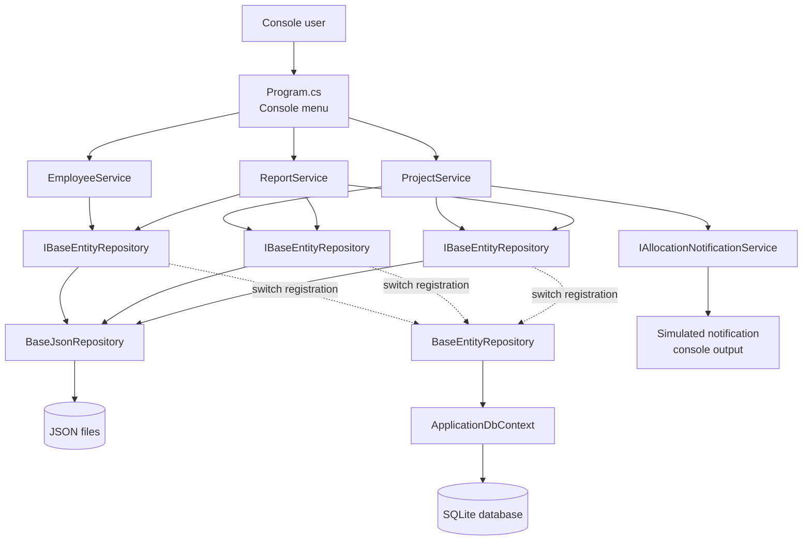
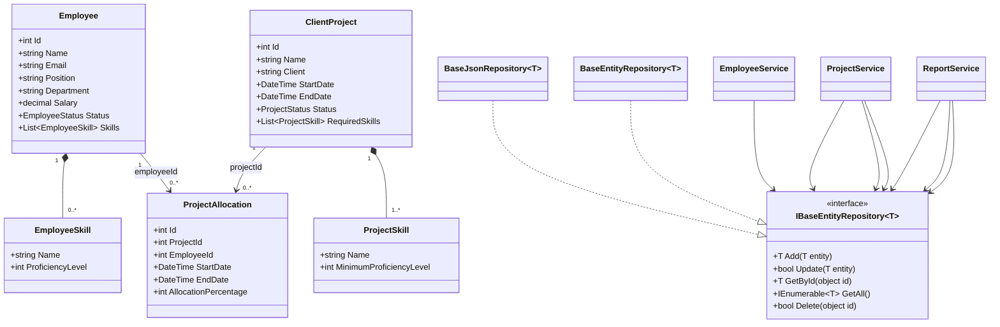

# Resource Management System Design

## Architecture overview

The application is a .NET 10 console application. `Program.cs` composes the application using dependency injection, the application services coordinate use cases, and generic repositories provide interchangeable JSON or EF Core persistence.

The repository implementation is selected in `Program.cs`. Services depend only on `IBaseEntityRepository<TEntity>`, so switching between JSON and EF Core does not require service changes.

## Domain and class diagram

`ProjectAllocation` uses foreign-key IDs rather than direct object references so the same model can be stored by both the JSON repository and EF Core repository. Employee skills and project required skills are collections with proficiency values from 1 through 5.

## Architecture Decision Records

### ADR-001: Use a layered console application

**Context**

The application is a console-based resource management system, but it contains employee management, project allocation rules, notifications, reporting, and persistence concerns. Keeping all logic in top-level statements would make those concerns difficult to test and change.

**Decision**

Use a small layered structure:

- `Program.cs` handles composition, dependency injection, and menu routing.
- Services handle use cases, console interaction, and business rules.
- Repository abstractions handle data access.
- Models represent domain data.

**Alternatives considered**

1. Put all application logic directly in `Program.cs`.
2. Build a larger web/API architecture even though the current requirement is a console application.
3. Use a single service containing employee, project, reporting, and persistence logic.

**Consequences**

- The console remains simple and the business logic has clear ownership.
- Services can be tested independently of menu routing.
- There is some additional structure and more files than a single-file prototype.
- Console input/output still exists in the services, so a future UI separation would require another refactoring.

### ADR-002: Depend on a generic repository abstraction

**Context**

The application must support both JSON-file persistence and EF Core persistence. Services should not change when the storage technology changes.

**Decision**

Use `IBaseEntityRepository<TEntity>` with the common operations `Add`, `Update`, `GetById`, `GetAll`, and `Delete`. Services inject this interface through constructors.

**Alternatives considered**

1. Inject `BaseJsonRepository<TEntity>` directly.
2. Inject `BaseEntityRepository<TEntity>` directly.
3. Create a separate repository interface and implementation for every model.
4. Access files or `DbContext` directly from services.

**Consequences**

- JSON and EF Core implementations can be selected through dependency injection.
- Service code is independent of the persistence mechanism.
- The common interface only exposes operations shared by both stores.
- Advanced provider-specific queries are not available through the abstraction without extending it.
- The current synchronous interface is simple but may need async methods for a production-scale application.

### ADR-003: Support JSON and EF Core through dependency injection

**Context**

JSON is useful for training, demonstration, and simple local execution. EF Core with SQLite provides a database-backed option. The application should be able to switch implementations without changing service constructors or business logic.

**Decision**

Register the open generic repository in `Program.cs`:

- `BaseJsonRepository<TEntity>` for JSON-backed execution.
- `BaseEntityRepository<TEntity>` for EF Core-backed execution.

The active registration determines the storage implementation.

**Alternatives considered**

1. Run only with JSON files.
2. Run only with EF Core.
3. Detect the storage mechanism inside each service.
4. Use a configuration-driven factory with custom runtime switching.

**Consequences**

- The default application is easy to run without database setup.
- EF Core can be adopted without changing the application services.
- Both implementations must honor the same repository behavior.
- JSON files and database schema can diverge if they are not maintained or migrated together.
- The current EF Core path requires database schema creation or migrations before use.

### ADR-004: Model skills with proficiency values

**Context**

Employees have skills, and projects require skills. Matching only by skill name is not enough because an employee may have insufficient experience for a project.

**Decision**

Represent skills as objects instead of strings:

- `EmployeeSkill` contains `Name` and `ProficiencyLevel`.
- `ProjectSkill` contains `Name` and `MinimumProficiencyLevel`.
- Proficiency values are constrained to 1 through 5.
- An employee matches a project when every required skill exists at or above the required level.

**Alternatives considered**

1. Store skills as `List<string>` with no proficiency.
2. Store skills as a dictionary of skill name to integer level.
3. Use a global skill catalog with normalized skill IDs.
4. Use free-form text fields on `Employee` and `ClientProject`.

**Consequences**

- Skill matching is explicit and understandable.
- JSON serialization is straightforward.
- EF Core can persist the collections as owned values.
- Duplicate skill names are not currently prevented.
- Skill names are compared case-insensitively but are still free-form strings; a normalized catalog may be needed later.

### ADR-005: Enforce allocation rules in the project service

**Context**

Allocation validity depends on several records: employee status, project dates, existing overlapping allocations, and the new allocation. The rules must apply regardless of whether data comes from JSON or EF Core.

**Decision**

Keep allocation validation in `ProjectService` before calling the allocation repository. Enforce:

- Allocation percentage is 1–100.
- Allocation dates are valid and inside the project dates.
- Inactive employees cannot be allocated.
- Overlapping allocation totals cannot exceed 100%.

Date ranges are inclusive when determining overlap.

**Alternatives considered**

1. Enforce rules only in the console input layer.
2. Enforce rules separately in each repository implementation.
3. Use database constraints or triggers only.
4. Add a separate domain rules engine.

**Consequences**

- Rules apply to both console calls and direct service calls.
- JSON and EF Core implementations share the same business behavior.
- Repository operations remain generic and focused on persistence.
- A concurrent multi-process application would need transaction or database-level protection to prevent race conditions between validation and insert.
- Date-sensitive reporting may need a more detailed interval model in the future.

### ADR-006: Use simulated console notifications

**Context**

The application must notify when an employee is allocated or released, but no email, messaging, or external notification provider has been specified.

**Decision**

Define `IAllocationNotificationService` and register `SimulatedAllocationNotificationService`, which writes notification messages to the console after successful persistence.

**Alternatives considered**

1. Write notification code directly inside `ProjectService`.
2. Send email or use a message broker.
3. Persist notifications in a database table.
4. Do not provide notifications until an external provider is available.

**Consequences**

- Allocation notifications are visible immediately during console use.
- A real provider can replace the simulated implementation through dependency injection.
- Notifications are not durable and are not delivered outside the running process.
- The service is called after the repository operation, so failed persistence does not produce a success notification.

### ADR-007: Use simple aggregate reports over recorded allocations

**Context**

The system requires a bench report, project staffing summary, and department utilization report. The current allocation model contains date ranges and percentages but no requested reporting date or calendar-period parameter.

**Decision**

Use the following definitions:

- Bench: active employees whose recorded allocation total is below 50%.
- Project staffing: distinct employees, active employees, allocation record count, and total recorded allocation per project.
- Department utilization: average recorded allocation per active employee, with each employee capped at 100%.

**Alternatives considered**

1. Require a reporting start and end date for every report.
2. Calculate only current-day utilization.
3. Count allocation records rather than percentages.
4. Use time-weighted utilization across calendar days.

**Consequences**

- Reports are easy to understand and run from the console.
- The reports work with both repository implementations.
- Totals across non-overlapping periods can overstate utilization because the current reports aggregate stored percentages without time weighting.
- A future reporting requirement should add a reporting period and interval-aware calculations.
