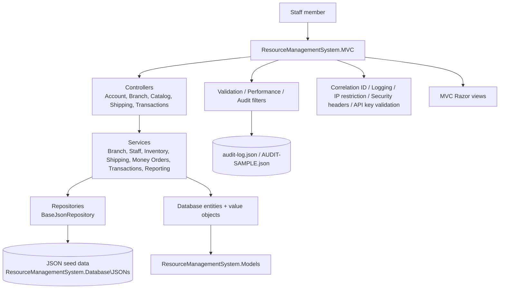
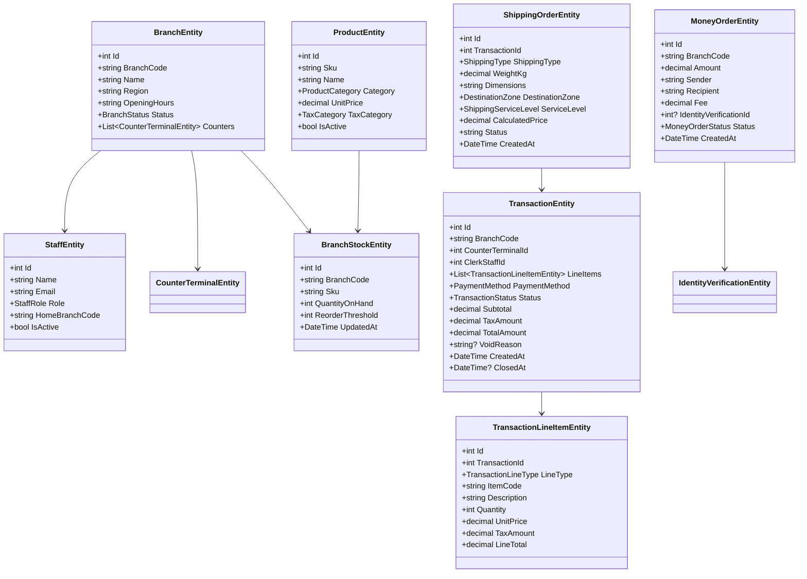

# ApexPost Design

## Architecture overview

This solution is designed as an MVC-first ApexPost branch operations platform. The active application is `ResourceManagementSystem.MVC`, while the legacy `ResourceManagementSystem` project remains a reference-only implementation and is intentionally not the application entry point.

## Domain model diagram

## Middleware pipeline

## Filter vs middleware matrix

| Concern | Type | Purpose | Example |
| --- | --- | --- | --- |
| Request correlation | Middleware | Adds a per-request ID to logs and response headers | `CorrelationIdMiddleware` |
| Request logging | Middleware | Records method, path, IP, and timing for observability | `RequestLoggingMiddleware` |
| Security headers | Middleware | Adds CSP, X-Frame-Options, X-Content-Type-Options | inline response pipeline |
| IP restrictions | Middleware | Blocks unauthorized addresses to admin/integration routes | `IpRestrictionMiddleware` |
| Maintenance mode | Middleware | Temporarily prevents usage during scheduled downtime | `MaintenanceModeMiddleware` |
| API key validation | Middleware | Validates `x-api-key` for protected integration endpoints | `ApiKeyValidationMiddleware` |
| Audit capture | Action filter | Records controller/action metadata and status for traceability | `AuditActionFilter` |
| Validation | Action filter | Ensures model state and request preconditions are valid | `ValidationFilter` |
| Performance timing | Action filter | Measures action duration and attaches timing metadata | `PerformanceFilter` |

## Layer responsibilities

### Database project

Contains persistence entities and JSON seed data. This is where the branch, staff, product, stock, shipping, identity verification, money-order, and transaction structures are defined.

### Models project

Contains value objects, DTOs, and MVC-facing input/output models. Examples include branch summaries, transaction request models, and money-order request payloads.

### Services project

Contains the real business logic and rules:

- stock sufficiency validation
- branch and staff restrictions
- identity verification requirements for high-value money orders
- shipping weight/service validation
- manager-only transaction void and refund enforcement
- summary and reporting generation

### MVC project

Contains controllers, Razor views, auth flow, policies, and UI composition.

### Utilities project

Contains the cross-cutting infrastructure used by the app:

- correlation ID and logging
- exception handling
- maintenance mode and rate limiting
- IP filtering and API key enforcement
- audit store and action filters

## Core business flow

1. A staff member signs in through the MVC login page.
2. The login request is validated by the authentication service.
3. A claims-based cookie identity is created with staff ID, role, and branch data.
4. Controllers call services rather than repositories.
5. Services enforce rules and persist records through the generic repository abstraction.
6. Audit and security middleware record request metadata and enforce policy.

## Decision records

### ADR-001: MVC is the primary application model

**Context**
The original codebase started as a console project, but the assignment and current runtime target require an MVC-first flow.

**Decision**
Use `ResourceManagementSystem.MVC` as the primary runtime application and keep `ResourceManagementSystem` as a legacy reference implementation.

**Consequences**
- The app matches the assignment UI expectations.
- Business logic can be separated cleanly from the web layer.
- The application becomes easier to test and secure.

### ADR-002: Business logic belongs in services

**Context**
The assignment explicitly requires that business logic live in the service layer.

**Decision**
All validation, stock checks, shipping calculations, money-order checks, transaction policy checks, and report generation are implemented in services.

**Consequences**
- Controllers remain thin and focused on HTTP concerns.
- Business rules are easier to test independently.
- Repositories remain low-level data access mechanisms.

### ADR-003: JSON persistence remains in the Database project

**Context**
The user required that JSON files and persistence models remain in the Database project.

**Decision**
The solution defines persistence entities under `ResourceManagementSystem.Database` and persists them through `BaseJsonRepository<TEntity>`.

**Consequences**
- The data layer is co-located with seed files.
- The MVC project stays decoupled from persistence decisions.
- The app remains portable and simple to demo locally.

### ADR-004: Cookie authentication for MVC

**Context**
The app is browser-based and not a tokenized API-first solution.

**Decision**
Use ASP.NET Core cookie authentication with claims for staff identity, role, and branch details.

**Consequences**
- The login flow feels native to MVC.
- Role and branch restrictions can be enforced using claims and policies.
- JWT would be a different architecture and is not the chosen implementation here.

### ADR-005: Authorization is policy-based

**Context**
Branch operations require different privileges by role and branch scope.

**Decision**
Use policies such as `BranchManagerOnly` and `SameBranchOnly` in the MVC authorization pipeline.

**Consequences**
- Managers can be restricted to manager-only actions.
- Staff access can be scoped to the same branch.
- Authorization remains consistent across controllers and actions.

### ADR-006: Audit logging is append-only and sanitized

**Context**
The system needs an audit trail without exposing sensitive values.

**Decision**
The audit filter writes rounded, sanitized entries to a JSON store and excludes secrets and protected document data.

**Consequences**
- The app remains auditable and reviewable.
- Sensitive data such as passwords and API keys are protected.
- Audit trails are easy to export or review manually.

### ADR-007: Security is enforced in middleware before the request reaches controllers

**Context**
The app needs protection at the platform boundary, not only at the controller level.

**Decision**
Correlation ID, logging, IP restrictions, header hardening, maintenance gating, and API-key enforcement are implemented as middleware.

**Consequences**
- Requests are filtered before controller code executes.
- Security concerns are centralized and reusable.
- The app is easier to reason about under load and incident conditions.

### ADR-008: Seed data is intentionally realistic and demonstrative

**Context**
The application must showcase branch operations, staff roles, transaction histories, and shipping scenarios in a convincing local demo.

**Decision**
The JSON seed files include multiple branches, diverse staff roles, realistic product catalog data, and historical transactions to support reporting and demos.

**Consequences**
- The app has enough data to make dashboards and reports useful.
- Demo flows feel realistic without requiring a live database.
- Documentation and screenshots can be based on actual dataset scenarios.

## SOLID mapping

| Principle | Application in this solution |
| --- | --- |
| Single Responsibility Principle | Services contain business operations, controllers handle HTTP, repositories handle file persistence |
| Open/Closed Principle | New services or policies can be added without changing core repository implementations |
| Liskov Substitution Principle | Repository abstractions are interchangeable for JSON-backed persistence |
| Interface Segregation Principle | Service interfaces such as `IShippingService`, `IMoneyOrderService`, and `ITransactionService` expose focused contracts |
| Dependency Inversion Principle | Controllers depend on abstractions (`IAuthenticationService`, `IBranchService`, etc.), not concrete implementations |

## Security and audit section

### Threats and mitigations

| Threat | Mitigation |
| --- | --- |
| Unauthorized access to admin or integration routes | IP restriction middleware and authorization policies |
| Credential stuffing against the MVC login page | Rate limiting on login endpoint |
| Missing request traceability | Correlation ID middleware and request logging |
| Sensitive information leakage in responses | Security headers and exception handling |
| Missing audit trail for business actions | Action filters that write sanitized audit entries |
| Protected integration abuse | `x-api-key` validation middleware |
| Downtime or maintenance window misuse | Maintenance-mode middleware |

### Audit model

Audit entries capture useful operational metadata without saving raw password data or secret material. Fields include:

- staff ID and role
- branch code
- controller and action name
- path and HTTP method
- result status code and execution duration
- correlation ID
- route values needed for traceability

Representative samples can be reviewed in `ResourceManagementSystem.Database\JSONs\AUDIT-SAMPLE.json`.

## Key domain entities

- `BranchEntity`
- `StaffEntity`
- `ProductEntity`
- `BranchStockEntity`
- `ShippingOrderEntity`
- `IdentityVerificationEntity`
- `MoneyOrderEntity`
- `TransactionEntity`
- `TransactionLineItemEntity`
- `CounterTerminalEntity`

## Key services

- `BranchService`
- `StaffService`
- `InventoryService`
- `ShippingService`
- `MoneyOrderService`
- `TransactionService`
- `ReportService`
- `AuthenticationService`
- `ProductCatalogService`

## Validation strategy

The project validates behavior through unit tests and MVC integration tests. The suite covers:

- stock sufficiency and inventory rules
- high-value money-order verification
- shipping price and parcel limit enforcement
- security middleware responses
- login and authorization behavior
- request logging and audit output

## Summary

The solution is deliberately layered to satisfy the assignment constraints: MVC is the active app, business logic lives in service classes, JSON persistence remains in the Database project, and security and audit concerns are enforced in middleware and filters.
