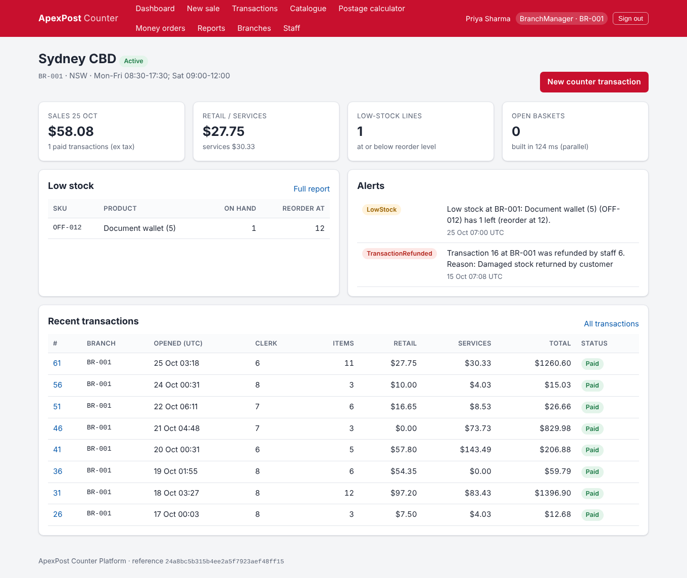
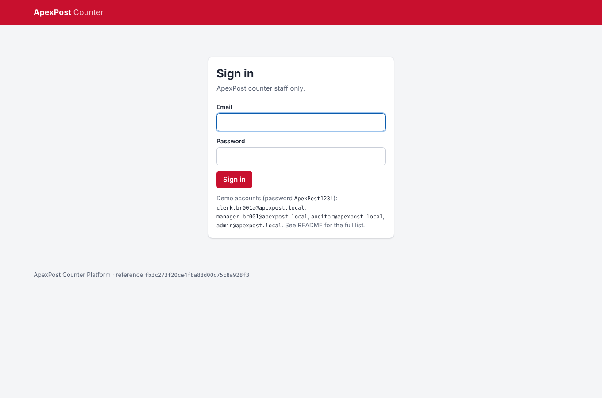
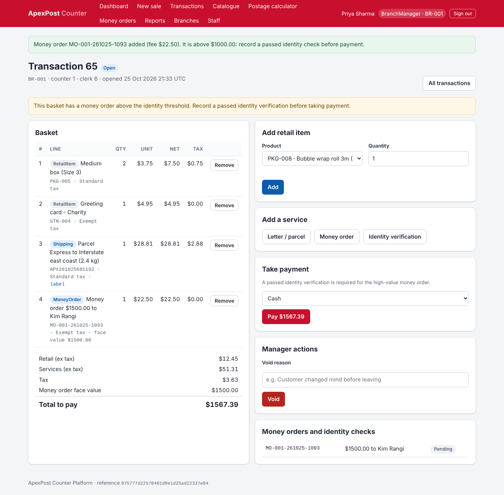
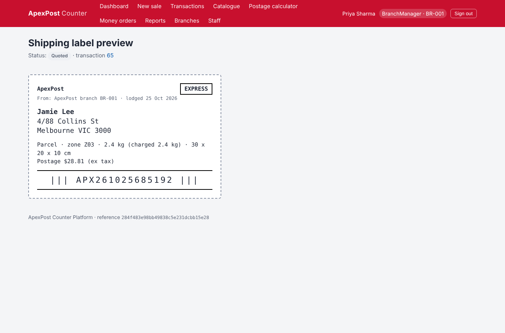
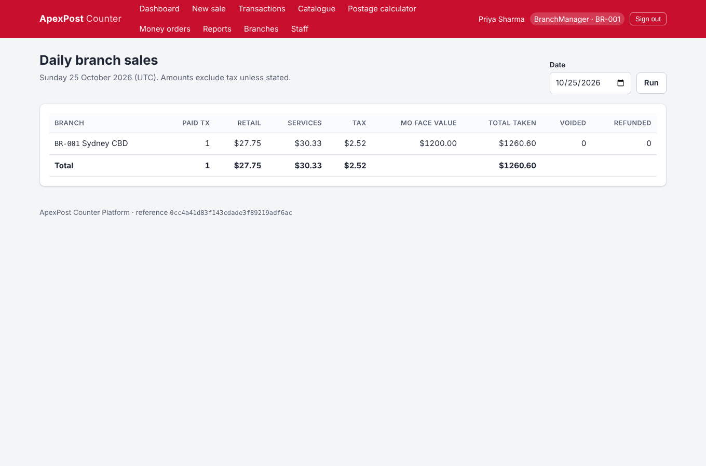
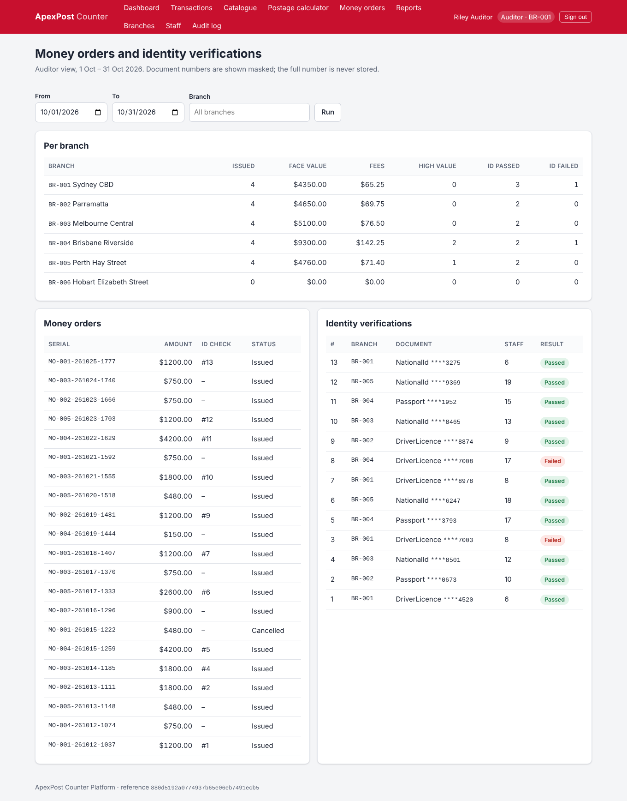
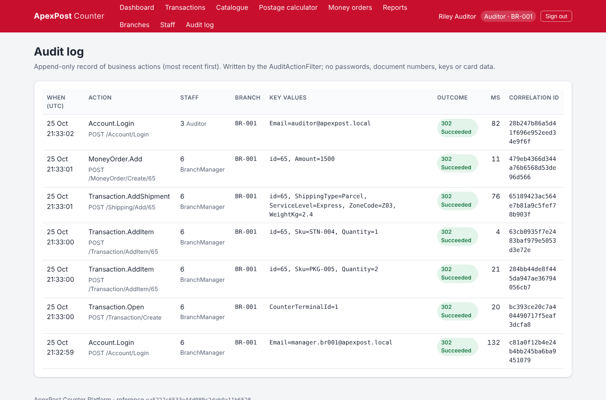

# ApexPost Counter Platform

ApexPost is a national postal, shipping and retail services provider. This is the counter platform
its branches use. From one counter, staff sell retail goods (packaging, stationery, office supplies)
alongside letters and parcels, money orders and identity verification. It is an ASP.NET Core MVC
app on .NET 10 / C# 14 with JSON-file persistence behind repository interfaces, and it replaces the
Week 1 TechNova resource-allocation console app.

* Architecture, middleware order, ADRs, security and audit design: **[DESIGN.md](DESIGN.md)**
* Sample audit entries produced by the audit filter: **[AUDIT-SAMPLE.json](AUDIT-SAMPLE.json)**
* Sample requests: **[ApexPost-Postman-Collection.json](ApexPost-Postman-Collection.json)**



## Solution structure

| Project | Role |
| --- | --- |
| `ApexPost.Models` | Domain primitives: value objects (`Money`, `Weight`, `Dimensions`, `Address`, `BranchCode`, `Sku`, `MaskedDocumentNumber`), C# 14 extension members, rule attributes + cached reflection validator, domain exceptions |
| `ApexPost.Database` | Persistence entities and enums, plus seed data in `JSONs/` |
| `ApexPost.Repositories` | `IBaseEntityRepository<T>` and the async `BaseJsonRepository<T>`, specifications, JSON converters, seeder |
| `ApexPost.Services` | All business logic: branches, staff, catalogue, inventory, shipping and pricing, money orders, transactions, reports, dashboard, events and notifications, courier simulation |
| `ApexPost.Utilities` | Middleware, MVC filters, the append-only audit store, the global exception handler |
| `ApexPost.MVC` | Composition root (`Program.cs`), authentication and policies, thin controllers, Razor views |
| `ApexPost.Tests` | xUnit unit tests and WebApplicationFactory integration tests (111 tests) |

Flow: **Controller → Service → Repository → JSON file**. Controllers never touch repositories, and
business rules live only in services.

## Prerequisites

* .NET 10 SDK
* Visual Studio 2026, Rider or VS Code
* A trusted HTTPS development certificate: `dotnet dev-certs https --trust`. Every cookie is
  `Secure`, so the app must be used over HTTPS.

## Run

```powershell
dotnet restore .\ApexPost.slnx
dotnet run --project .\ApexPost.MVC --launch-profile https
```

Open **https://localhost:7052**. On first start the seed files are copied to
`ApexPost.MVC\App_Data\` (git-ignored); runtime changes and the audit log
(`audit-log.jsonl`) are written there. Delete `App_Data` to reset the demo data.

## Demo accounts

All demo accounts use the password **`ApexPost123!`**. It is stored only as PBKDF2 hashes in
`StaffEntity.json`. There are 24 staff in total; these cover every role and rule:

| Email | Role | Branch | Use it to show |
| --- | --- | --- | --- |
| `clerk.br001a@apexpost.local` | Counter Clerk | BR-001 Sydney CBD | Sales, shipping, money orders, ID checks; gets **403** on void/refund |
| `clerk.br001b@apexpost.local` | Counter Clerk | BR-001 | A second clerk at the same branch |
| `manager.br001@apexpost.local` | Branch Manager | BR-001 | Void/refund with a reason, stock adjustments, open/close own branch, manage own clerks |
| `manager.br003@apexpost.local` | Branch Manager | BR-003 Melbourne Central | Branch isolation (cannot act on BR-001) |
| `auditor@apexpost.local` | Auditor | BR-001 | All-branch reports, the money order / ID audit view, `/Admin/Audit` |
| `admin@apexpost.local` | Administrator | BR-001 | Branches, all staff, audit log |
| `clerk.br006a@apexpost.local` | Counter Clerk | BR-006 Hobart (**Closed**) | "A closed branch cannot accept transactions" |
| `former.clerk@apexpost.local` | Counter Clerk (**inactive**) | BR-002 | Inactive staff cannot sign in or transact |

Naming pattern: `manager.br00N@`, `clerk.br00Na@` and `clerk.br00Nb@` for branches BR-001 to BR-006.

## Integration API key (user-secrets)

The courier-partner endpoint `GET /integration/parcel-status/{trackingNumber}` requires an `X-Api-Key`
header. Keys are configured **per partner** and never committed:

```powershell
dotnet user-secrets set "Integration:Partners:swiftcourier" "<a-long-random-key>" --project .\ApexPost.MVC
dotnet user-secrets list --project .\ApexPost.MVC
```

(In other environments use the environment variable `Integration__Partners__swiftcourier`.)
Responses: **401** for a missing or wrong key, **500** if no key is configured (the endpoint fails
closed), **403** from an address outside `IpRestriction:AllowList` (loopback and `10.20.0.0/16` by
default), **429** when the partner exceeds its budget, **404** for an unknown tracking number, and
**503** when the courier lookup times out (try a tracking number ending in `999`).

## Features

**Domain (Part A)**
* Branches with code, name, region, opening hours, Active/Closed status and counter terminals; staff
  add, edit and deactivate with the four roles; products with SKU, category, price and tax
  category; stock held per branch.
* A counter basket that mixes retail items, letters and parcels (zone, weight, dimensions, service
  level, recipient), money orders and identity verification, with tax, payment method and the
  Open → Paid → Voided/Refunded lifecycle.
* All business rules enforced in services: stock never negative (atomic, concurrency-safe), inactive
  staff blocked, clerks limited to their branch, high-value money orders need a passed ID check in
  the same transaction, parcel weight limits per service level, void/refund only by a Branch Manager
  with a reason, closed branches cannot trade.
* Reports (each also available as `?format=json`): daily branch sales (retail vs services), low stock
  (with a threshold you choose), shipping volume by zone and service level, and money orders with ID
  verifications per branch (the auditor view).
* Simulated notifications through events and an observer: low stock, high-value money order, every
  void and refund (logged as `[NOTIFY]` and shown on the dashboard).

**Advanced C# 14 (Part B):** records and value objects, pattern matching, C# 14 extension members, the
`field` keyword, constrained generics + specifications, delegates, events, custom attributes with a
cached reflection validator, async/await with `CancellationToken` end to end, `Task.WhenAll`,
`SemaphoreSlim`, `ValueTask` + `IMemoryCache`, and timeout versus cancellation. DESIGN.md §10 maps
each feature to the problem it solves.

**MVC (Part C):** login, branch dashboard, product catalogue with stock, counter transaction
(basket) screen, shipping label preview, postage calculator, money order and identity verification
forms, report pages, staff and branch management, audit log viewer. Conventional routing, PRG
after every successful POST, and the right action results (View, RedirectToAction, NotFound,
BadRequest, Forbid, Json, StatusCode).

**Middleware (Part D):** Problem Details exception handling, correlation ID, structured request
logging and timing, maintenance mode, security headers + HSTS + HTTPS, API key validation via
endpoint metadata, IP allowlist, cookie authentication with claims and policies, antiforgery,
rate limiting (login and per partner), CORS for the partner widget, and `/health`.

**Filters (Part E):** `AuditActionFilter` (append-only JSONL audit), `ValidationFilter`,
`PerformanceFilter` (slow-action warning + `Server-Timing` header) and `DomainExceptionFilter`.

## Screenshots

| | |
| --- | --- |
|  |  |
|  |  |
|  |  |

## Sample requests

```powershell
# Health (anonymous, available even in maintenance mode)
curl -k https://localhost:7052/health

# Integration endpoint: 401 without a key
curl -k -i https://localhost:7052/integration/parcel-status/APX000000000

# With the key you stored in user-secrets (404 for an unknown tracking number, 200 for a seeded one)
curl -k -i -H "X-Api-Key: <your key>" -H "X-Correlation-Id: demo-123" https://localhost:7052/integration/parcel-status/APX000000000

# Reports as JSON (sign in with a browser first; reports need the auth cookie)
https://localhost:7052/Report/DailySales?format=json
https://localhost:7052/Report/ShippingVolume?from=2026-10-01&to=2026-10-31&format=json
```

Import `ApexPost-Postman-Collection.json` into Postman for the same requests, with variables for
the base URL and API key.

## Configuration

| Section | Purpose |
| --- | --- |
| `Storage:DataDirectory` | Where live JSON data and the audit log are written (default `App_Data`) |
| `BusinessRules` | Money order identity threshold (default $1,000), high-value alert ($2,500), fees, low-stock threshold |
| `Courier` | Simulated partner latency, the concurrency limit (SemaphoreSlim) and the tracking timeout |
| `MaintenanceMode` | `Enabled`, `RetryAfterSeconds`, `Message` (re-read on every request) |
| `IpRestriction` | Allowlist (IPs or CIDR) and protected path prefixes |
| `ForwardedHeaders:KnownProxies` | Reverse proxies whose `X-Forwarded-For` is trusted (only loopback by default) |
| `RateLimiting` | Login and per-partner limits |
| `Cors:PartnerTrackingWidgetOrigins` | The only browser origin allowed to call the parcel-status endpoint |
| `Performance:SlowActionThresholdMs` | Threshold for the slow-action warning |

## Tests

```powershell
dotnet build .\ApexPost.slnx   # zero warnings: TreatWarningsAsErrors is on
dotnet test  .\ApexPost.slnx
```

There are 111 tests. **Unit tests** cover the stock rule (including concurrent overselling), the
money order identity rule, parcel weight limits, pricing and tax, value objects, the reflection
validator cache, specifications, redaction, SemaphoreSlim bounds, timeout versus cancellation, and
the measured cache speed-up. **Integration tests** use `WebApplicationFactory`: security headers,
401 without an API key, 403 from a blocked (and spoofed) IP, 429 on login, the redirect to login for
anonymous users, 403 when a clerk voids, the returned `X-Correlation-Id`, maintenance mode, Problem
Details with no stack trace, CORS, and full audited sale and void flows that check no sensitive
data was written.

## Git workflow

The work is on the feature branch `feature/week2-apexpost-counter-platform`, with one commit per
layer, and is merged through a pull request. No secrets are committed: API keys live in
user-secrets, `App_Data/` is ignored, and passwords are stored as hashes only.
